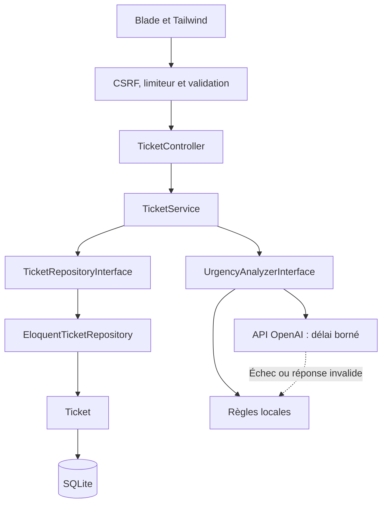

# Fast Track Support

**[Découvrir le prototype Figma](https://www.figma.com/design/zSb6GQW643fxGDIT9Y5eNp/Untitled?node-id=2-3)**

Mini-application de support en français : création de tickets, file filtrée et paginée,
consultation et recommandation d’urgence expliquée. La priorité humaine est conservée.

## Démarrage avec Docker (recommandé)

Prérequis : Docker avec Compose v2, moteur démarré et connexion internet pour le premier build.
Aucune installation locale de PHP, Composer, Node.js ni clé API n’est nécessaire.

```bash
git clone https://github.com/Ibrahimkas68/fast_track_support.git
cd fast_track_support
docker compose up -d --build
docker compose ps
```

Attendre l’état `healthy`, puis ouvrir **http://localhost:8080/tickets**.
Le premier démarrage génère la clé applicative, applique les migrations et crée les neuf
exemples. Les redémarrages conservent les tickets et ne rejouent pas les exemples.
Le build utilise les fichiers de dépendances verrouillés, compile les assets et exclut
les dépendances PHP de développement. Apache sert uniquement le dossier `public`.

```bash
docker compose logs -f app
docker compose down
# Relancer avec les mêmes données :
docker compose up -d
```

SQLite, la clé et les fichiers Laravel sont persistés dans le volume `app-data`, séparé
de votre base locale. `docker compose down -v` supprime définitivement ces données.
Pour changer le port : `APP_PORT=8081 docker compose up -d`.
Les variables facultatives OpenAI peuvent être définies dans votre environnement ou
votre `.env` local, qui n’est jamais copié dans l’image. Après modification, recréer
le conteneur avec `docker compose up -d --force-recreate`.

Vérifié sur ARM64 : build complet, conteneur sain, création HTTP avec CSRF, chargement
des assets, protection des fichiers privés et conservation des dix tickets de contrôle
ainsi que de la clé après remplacement du conteneur. La suite PHP locale passe
également : 169 tests, 612 assertions. Le démarrage ne lance pas les tests dans l’image.

Cette configuration sert la démonstration sur l’interface locale uniquement. Elle reste
à une instance avec SQLite. Une montée en charge multi-instance nécessiterait une base
partagée validée, un stockage partagé, une clé commune et des migrations exécutées
séparément avant le démarrage des instances. Aucun déploiement public sans authentification
n’est prévu par ce livrable.

## Installation locale

Prérequis : **PHP 8.4.1+** pour les dépendances verrouillées, Composer 2, SQLite,
extension mbstring et **Node.js 22.12+** avec npm. Vérifié avec PHP 8.4.1 et Node 22.22.3.
Une connexion internet peut être nécessaire pour les dépendances et les polices du build.

```bash
git clone https://github.com/Ibrahimkas68/fast_track_support.git
cd fast_track_support
composer install
cp .env.example .env
php artisan key:generate
touch database/database.sqlite
php artisan migrate --seed
npm ci
npm run build
php artisan serve
```

Ouvrir l’adresse indiquée par Artisan, puis `/tickets`. Sans configuration supplémentaire,
l’analyse fonctionne localement. Aucune clé LLM n’est nécessaire.

Les seeds créent neuf tickets fictifs, reconnaissables à `[Démo]`, couvrant chaque combinaison
statut/priorité. Ils peuvent être rejoués sans doublon. Les sources `llm` des seeds sont
explicitement des exemples fictifs, sans appel réseau. Les analyses Figma sont aussi simulées.

## Analyse facultative par OpenAI

Dans votre `.env` local :

```dotenv
URGENCY_DRIVER=openai
OPENAI_API_KEY=votre_cle_locale
OPENAI_MODEL=gpt-4o-mini
URGENCY_CONNECT_TIMEOUT=2
URGENCY_TIMEOUT=5
TICKET_RATE_LIMIT=10
```

Puis `php artisan config:clear`. Ne publiez jamais la clé ni votre `.env`.
Le délai total est positif et limité à 5s ; le délai de connexion doit être positif et
inférieur ou égal au total. Aucun retry automatique. Une clé absente, une panne ou une
réponse refusée/invalide déclenche le secours local. Un driver inconnu est une erreur de configuration.

Seule la description est envoyée à OpenAI, avec `store=false`. Cette option ne garantit
pas l’absence de toute rétention fournisseur. Évitez les données confidentielles.
Les tests simulent l’API ; aucun appel payant réel n’a été utilisé pour la validation.

## Vérifier

```bash
php artisan test --compact
vendor/bin/pint --dirty --format agent
npm run build
```

Les tests utilisent SQLite en mémoire et simulent les appels externes. Ils n’exigent pas
le build frontend ; celui-ci est vérifié séparément. Hors dépôt Git, utiliser
`vendor/bin/pint app config database routes tests --format agent` à la place de `--dirty`.

Les pages création/détail fonctionnent sans JavaScript. JavaScript ajoute les panneaux,
la gestion du focus et le blocage des envois simultanés. Les formulaires restent des POST
classiques avec CSRF. Le limiteur est partagé par IP, donc aussi entre utilisateurs derrière
une même adresse réseau. Il ne constitue pas une authentification.

## Architecture et documentation

Laravel 13.39, Blade, Tailwind 4, Vite 8, SQLite et Pest 5. La chaîne métier est :
**Controller → Service → TicketRepositoryInterface → Eloquent → Ticket**.
Le fournisseur est isolé derrière `UrgencyAnalyzerInterface`.



[Voir la séquence de création et le modèle de données](docs/architecture-docs.md#diagrammes).

| Document | Contenu |
|---|---|
| [Cahier des charges](docs/cahier-des-charges.md) | Besoin et périmètre |
| [Architecture](docs/architecture-docs.md) | Choix et sécurité |
| [Diagrammes Mermaid](docs/architecture-docs.md#diagrammes) | Architecture, séquence et données affichées directement sur GitHub |
| [Plan](specs/001-support-ticket-triage/plan.md) | Conception et évolutions possibles |
| [Routes web](specs/001-support-ticket-triage/contracts/web-routes.md) | Contrat des endpoints HTML |
| [Analyse](specs/001-support-ticket-triage/contracts/urgency-analysis.md) | Fournisseur et secours |
| [Composants](specs/001-support-ticket-triage/contracts/ui-components.md) | Layouts, props et accessibilité |
| [Vérifications](docs/verification.md) | Résultats réellement exécutés et limites |
| [Livraison](docs/livraison.md) | Checklist de remise |
| [Constitution](.specify/memory/constitution.md) | Principes du projet |

## Limites

Démonstration locale sans authentification. Aucune édition, suppression, assignation,
pièce jointe ou notification. Aucune API REST publique ; les contrats HTTP et tests Pest
couvrent les routes Blade. Le secours reconnaît des expressions françaises documentées,
avec une gestion limitée des négations, sans compréhension linguistique exhaustive.
SQLite et analyse synchrone conviennent à ce livrable ; PostgreSQL et jobs demanderaient
une évolution distincte. Aucune capacité de charge ni compatibilité PostgreSQL n’est revendiquée.
