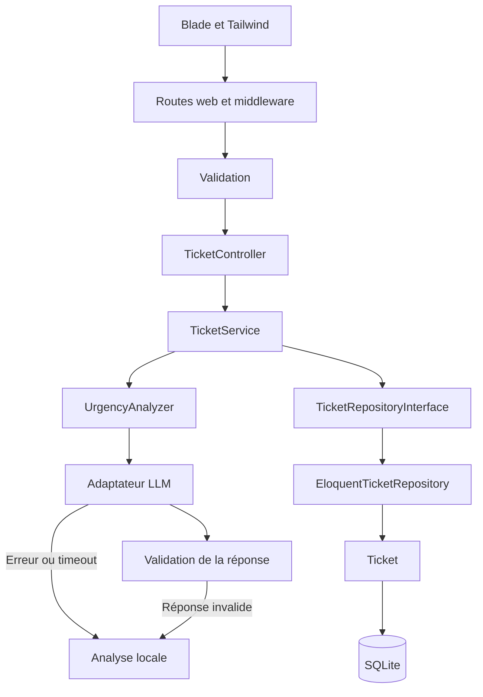

# Architecture proposée

Statut : conception à valider. Les composants métier ne sont pas encore implémentés.

## Choix techniques

| Élément | Choix et justification |
|---|---|
| Application | Monolithe Laravel 13 : un projet et des conventions communes |
| Interface | Blade et Tailwind : rendu serveur et composants réutilisables |
| Base | SQLite pour une installation locale simple |
| Persistance | Repository Eloquent derrière TicketRepositoryInterface |
| Analyse | Adaptateur LLM interchangeable et analyseur local indépendant |
| Vérification | Pest, puis parcours navigateur et QA manuelle |

Symfony et CodeIgniter sont autorisés, mais Laravel est déjà initialisé. Une application Vue/Nuxt séparée ajouterait une seconde application et un contrat REST sans besoin identifié dans le périmètre retenu.

## Diagrammes

Ouvrir [architecture.drawio](architecture.drawio) dans Draw.io / diagrams.net. Trois pages : architecture, création d’un ticket et données.

## Responsabilités

| Composant | Rôle |
|---|---|
| Middleware web | CSRF, session et limitation des requêtes concernées |
| Validation de requête | Champs obligatoires, longueurs et valeurs autorisées |
| TicketController | Entrée HTTP, appel du service et réponse Blade/redirection |
| TicketService | Coordination de la création et de l’analyse |
| TicketRepositoryInterface | Contrat de création et de consultation filtrée |
| EloquentTicketRepository | Persistance et requêtes via le modèle Ticket |
| UrgencyAnalyzer | Appel LLM, validation du résultat et secours local |
| Adaptateur LLM | Appel HTTP et traduction de la réponse fournisseur |
| Analyseur local | Règles textuelles, explication et valeur par défaut documentées |

Le conteneur Laravel associe l’interface du repository à son implémentation. Les contrôleurs ne contiennent pas de requêtes de persistance.

## Flux de création

1. Vérifier le jeton CSRF et valider les données côté serveur.
2. Analyser la description avec un délai total court, borné et configurable.
3. Valider la priorité retournée et limiter la longueur de l’explication.
4. Utiliser le secours local si la clé manque, si l’appel échoue ou si la réponse est invalide.
5. Enregistrer le ticket et sa recommandation, puis afficher la confirmation.

Aucune transaction de base de données ne reste ouverte pendant l’appel réseau. Une erreur de base est un échec de création ; une erreur LLM déclenche le secours.

## Modèle de données proposé

| Champ Ticket | Rôle |
|---|---|
| id | Identifiant utilisé pour la référence FT-… |
| title / description | Demande conservée comme texte |
| priority | Choix humain : low, medium, high |
| status | open, in_progress, resolved |
| suggested_priority | Recommandation : low, medium, high |
| analysis_reason | Explication courte |
| analysis_source | llm ou local |
| created_at / updated_at | Dates techniques |

Prévoir pagination, ordre stable par date puis identifiant et index adaptés aux filtres. Les libellés français appartiennent à la présentation.

## Sécurité

- Validation serveur des créations et filtres, avec taille de description bornée.
- Requêtes Eloquent paramétrées ; aucune concaténation SQL depuis les entrées.
- Affichage Blade échappé ; description et réponse LLM traitées comme texte non fiable.
- CSRF sur les formulaires et limitation des créations pour maîtriser abus et coûts.
- Champs persistés explicitement sélectionnés après validation.
- Clé LLM côté serveur ; destination fournisseur configurée par l’application.
- Description transmise au modèle comme donnée, sans outils ni actions externes ; résultat toujours validé.
- Transmettre uniquement le texte nécessaire et documenter ce traitement.
- Journaux sans clés, descriptions complètes ou réponses brutes sensibles.
- Erreurs publiques sobres ; détails techniques réservés au développement et aux journaux.
- Sans authentification, le périmètre reste une démonstration locale. De vrais utilisateurs nécessitent des contrôles d’accès.

## Évolution

| Besoin constaté | Évolution possible |
|---|---|
| Écritures concurrentes plus nombreuses | PostgreSQL et vérification des requêtes sur cette base |
| Analyse trop lente | Enregistrement immédiat, puis job avec état pending/completed |
| Retraitement asynchrone | Idempotence et contrôle de version ; préserver la priorité humaine |
| Plusieurs instances web | Sessions/cache partagés et workers séparés si nécessaire |

Ces évolutions restent hors du premier livrable. Aucune infrastructure distribuée n’est nécessaire pour le test.

## Exécution

PHP local avec assets Vite compilés. Le navigateur ne contacte pas directement le LLM. OpenAPI pourra accompagner une future API REST ; le rendu Blade retenu n’en nécessite pas. Voir [livraison.md](livraison.md).
